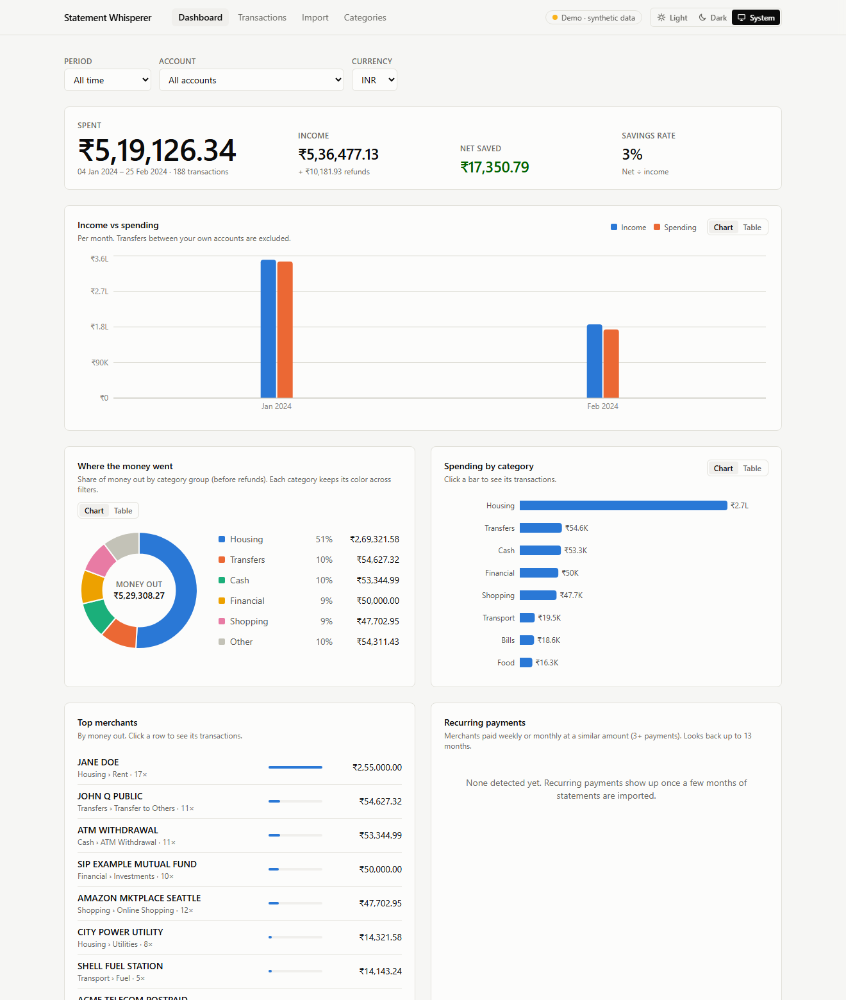
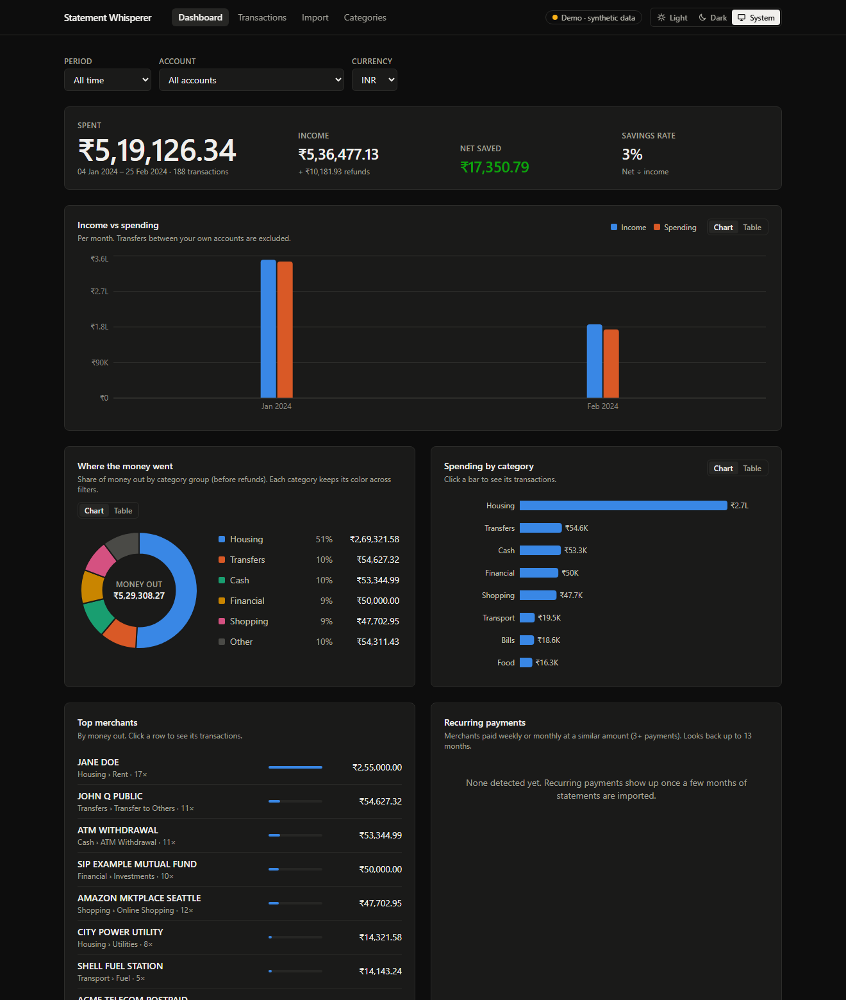
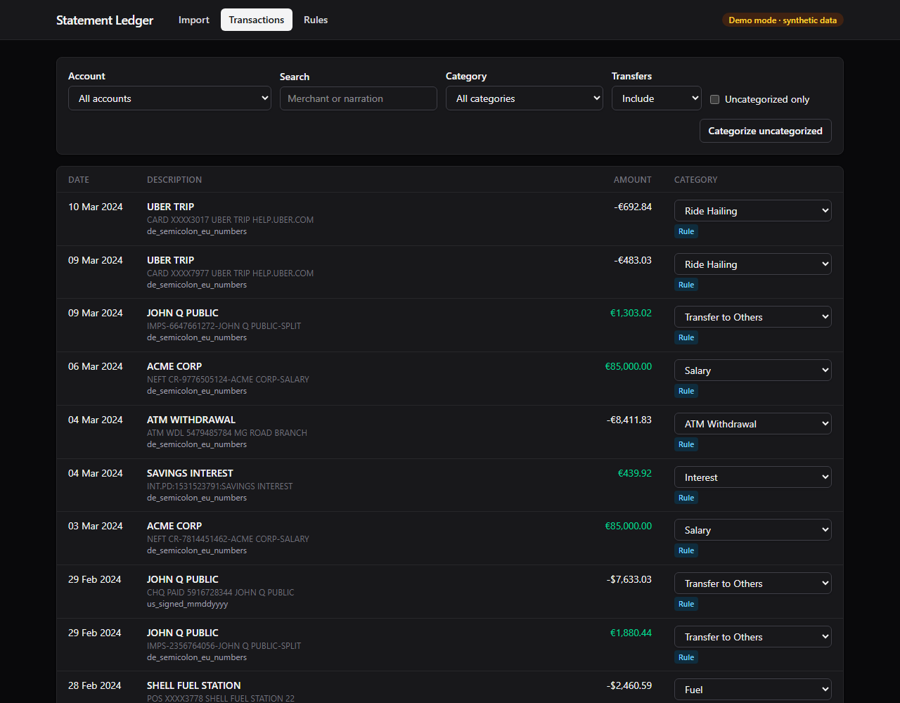
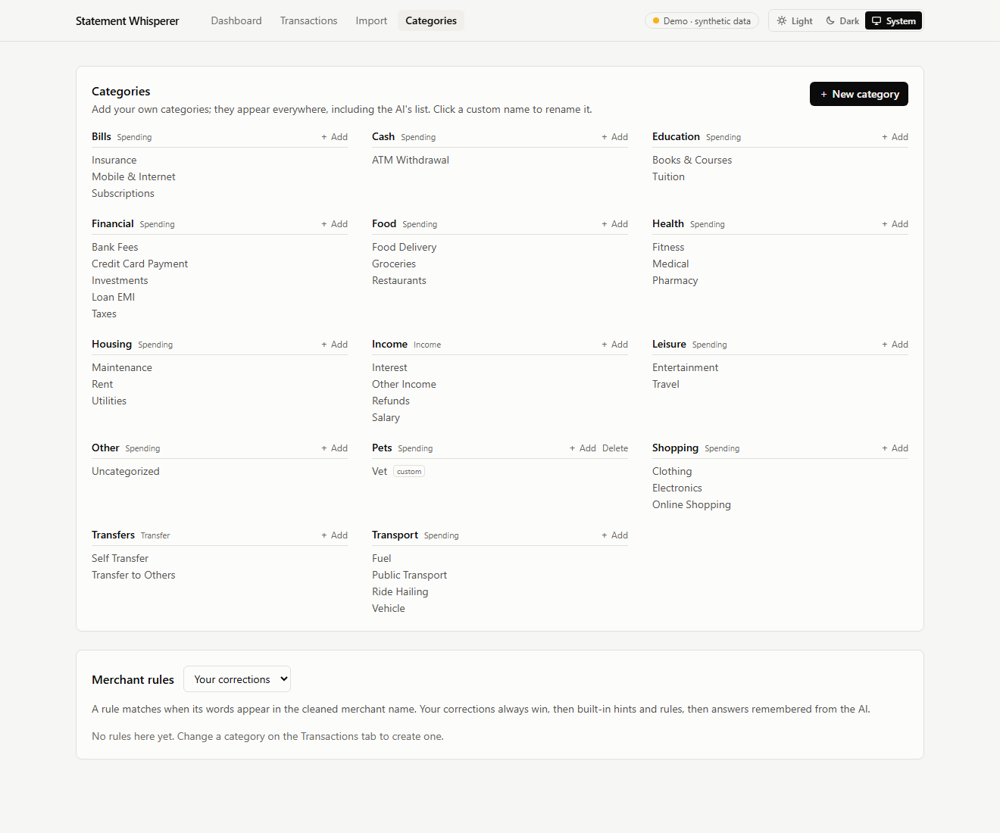
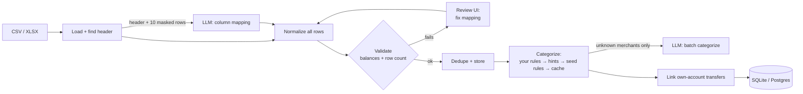

# Statement Whisperer

> Talks to any bank's statement so you don't have to.

A personal-finance ledger that works with statements from any bank. Upload a CSV or XLSX statement (PDF support comes later). The app:

- works out the statement's layout at runtime,
- normalizes every transaction into one schema,
- checks the result against the statement's own balances,
- categorizes it, and stores it permanently without duplicates.

There is no parser per bank. An LLM looks at a small, masked sample to infer the column layout, plain code applies that layout to every row, and strict validation catches any mistake before data is stored. Categorization works in layers: your own rules come first, then built-in hints and rules, then cached answers, and only unknown merchants go to the LLM.

> **Status:** Phase 3 (dashboard and light/dark theme) is complete. Next: PDF statements. See the [roadmap](#roadmap).

## Screenshots

| Dashboard (light) | Dashboard (dark) |
|---|---|
|  |  |

| Transactions with inline category editing | Categories (built-in + your own) |
|---|---|
|  |  |

_Demo mode, synthetic data only._

## Architecture



The full pipeline, data model and design notes are in [docs/architecture.md](docs/architecture.md).

**Stack:**
- Backend: FastAPI · SQLAlchemy 2 · Alembic · openpyxl · Anthropic API (structured output) · pytest
- Frontend: React 19 · Vite · Tailwind 4 · TanStack Table · Recharts · Vitest

## Supported layouts

Each of these is covered by a synthetic statement in [`samples/synthetic/`](samples/synthetic) and checked against ground truth by the test suite:

| Layout | Format | Highlights |
|---|---|---|
| `in_debit_credit_ddmmyy` | CSV | Preamble lines, separate withdrawal/deposit columns, `DD/MM/YY`, Indian grouping `1,23,456.78`, totals footer |
| `us_signed_mmddyyyy` | CSV | One signed amount column, `MM/DD/YYYY` |
| `de_semicolon_eu_numbers` | CSV `;` | `DD.MM.YYYY`, `1.234,56` |
| `iso_shuffled_debit_credit` | CSV | Unusual column order, `YYYY-MM-DD` |
| `drcr_suffix_amounts` | CSV | `1,200.00 Dr` / `Cr` amounts and balances |
| `type_column_gbp` | CSV | Unsigned amount plus a `DR`/`CR` type column, `05 Jan 2024` |
| `reverse_chronological` | CSV | Newest first, detected from the balance chain |
| `no_balance_cad` | CSV | No balance column (balance checks skipped, with a warning) |
| `xlsx_native_cells` | XLSX | Real date and number cells, preamble |
| `xlsx_eu_strings` | XLSX | European number strings |
| `tsv_credit_card_positive_debits` | TSV | Charges shown as positive, `05-Jan-24` |
| `multiline_narration` | CSV | Narrations wrapped onto continuation rows |
| `opening_closing_rows_space_thousands` | CSV | Opening/closing balance lines, `12 345.00` |
| `chf_parentheses_apostrophe` | CSV | `(1'234.50)` negatives |
| `jpy_trailing_minus_no_decimals` | CSV | `1,234-` negatives, zero-decimal currency, `05JAN2024` |

Also handled: CSV with no header, CP1252/Latin-1 encodings, repeated header rows, end-of-day-only balances, same-day identical transactions, and overlapping statements.

## Dashboard

One filter row (period, account, currency) scopes everything below it:

- **Spent** (the headline figure), plus **income**, **net saved** and **savings rate**.
- **Income vs spending:** per week for ranges up to 45 days, per month beyond that.
- **Where the money went:** a donut chart of your top 5 category groups plus "Other". Each group keeps its colour when you change filters, because colours follow the group's all-time rank.
- **Spending by category:** ranked, with the top 8 shown and the rest folded into "Other". Click a bar or slice to open its transactions.
- **Top merchants:** click a row to open its transactions.
- **Recurring payments:** merchants paid weekly or monthly at a similar amount, with the next expected date and the cost per month.

How the numbers are defined:
- **Transfers:** money moved between your own accounts is left out of everything. Payments to other people count as spending.
- **Refunds:** they reduce spending rather than counting as income.
- **Currencies:** amounts in different currencies are never added together.

Every chart has a **Table** view, so no value is only visible on hover. Chart colours come from a palette checked for colour-blind safety and contrast in both themes. The **Light / Dark / System** switch in the header is remembered per browser.

## How categorization works

1. **Merchant cleanup:** `UPI/412345678901/SWIGGY/jdoe@okaxis/Payment` becomes `SWIGGY`. Channel prefixes, reference numbers, card digits and UPI handles are stripped.
2. **Your rules:** every manual correction is saved as a rule and wins over everything else. It is also applied to other transactions with the same merchant.

**Custom categories.** Add your own on the **Categories** tab, or pick "＋ New category…" from any transaction's category menu. A new category can go under an existing group or in a new group (counted as spending, income or transfer). Your own categories can be renamed or deleted; deleting one makes its transactions uncategorized and removes its rules. Built-in categories are locked, because the categorizer refers to them by name.
3. **Built-in hints:** ATM withdrawals, SALARY/INTEREST/REFUND credits, and EMI/SIP/RENT/fee debits. Person-to-person payments are categorized as *Transfer to Others* and their names are never sent to the LLM.
4. **Seed rules:** about 60 common brands (Swiggy, Amazon, Uber, Netflix, Shell, Jio, Vodafone…). They're checked before the person heuristic, so a bank-truncated `VODAFONE IDEA` still counts as a phone bill.
5. **Cache:** earlier LLM answers, stored as rules.
6. **LLM:** the remaining unique merchants are sent in one batch, with a fixed category list and structured output.

Money in from an expense-type merchant counts as a refund. A debit and an equal credit in two of your accounts within 3 days are linked as a transfer between your own accounts. Those are excluded from income and expense, and you can unlink a wrong match.

## Privacy

- **Sent to the LLM:**
  - For layout detection: the header labels and **up to 10 masked rows**. Narrations and names become `<text:N>` and account/reference numbers become `<digits:N>`.
  - For categorization: **cleaned merchant names only** (identifiers masked), never person names.
  - Preamble lines (account holder, account number) are never sent.
- **Stored:** normalized transactions, file hashes, the column mapping, the validation report and merchant rules. **Not stored:** uploaded files (processed in memory), file names, full account numbers (last 4 only), passwords.
- **Logged:** import and categorization metadata only. SQL parameters are hidden even at DEBUG level.
- **Offline option:** see [Using it for free](#using-it-for-free-no-api-key). Demo mode never makes network calls.

Details are in [docs/privacy.md](docs/privacy.md).

## Using it for free (no API key)

The API key is optional. Leave `ANTHROPIC_API_KEY` empty and nothing ever leaves your machine:

- **Layout:** the first statement from a bank stops at the review screen, with columns pre-guessed from the header names. Once it imports successfully, the mapping is **remembered for that column layout**. Every later statement with the same columns, from any of your accounts, imports straight through. Every import is still validated, and if a saved mapping stops fitting, you're sent back to the review screen with it pre-filled.
- **Categories:** built-in rules and hints handle common brands, ATM withdrawals, salary, interest, refunds, loan EMIs, rent and payments to people. Anything else stays *Uncategorized* until you pick a category once. That becomes a rule for the merchant and is applied to all its other transactions.

With a key, the AI only fills the gaps: new layouts, and merchants no rule covers yet.

## Setup (Windows / PowerShell)

Requirements: Python 3.11+, Node 20+ and Git.

```powershell
git clone https://github.com/Aditya-MC/statement-whisperer.git
cd statement-whisperer
copy .env.example .env            # set ANTHROPIC_API_KEY (optional, see Privacy)
.\scripts\dev.ps1 setup           # backend\.venv + frontend\node_modules, both inside the project
.\scripts\dev.ps1 migrate         # creates backend\ledger.db
.\scripts\dev.ps1 test            # pytest (prints the corpus pass rate), then Vitest
.\scripts\dev.ps1 build           # builds the UI into frontend\dist
.\scripts\dev.ps1 run             # app at http://127.0.0.1:8000, API docs at /docs
```

For UI development, run `.\scripts\dev.ps1 run` and `.\scripts\dev.ps1 web` side by side, then open http://127.0.0.1:5173. Vite proxies `/api` to the backend.

Caches stay on D: `dev.ps1` sets `PIP_CACHE_DIR=D:\dev-cache\pip` for its own process only, and `frontend/.npmrc` points npm's cache at `D:\dev-cache\npm`.

**Windows Smart App Control:** it blocks unsigned compiled Python extensions (`.pyd`). The backend avoids them: XLSX is read with pure-Python openpyxl, and `dev.ps1 setup` installs SQLAlchemy and mypy without their compiled speed-ups. If you see *"An Application Control policy has blocked this file"*, re-run `.\scripts\dev.ps1 setup`.

### Demo mode (synthetic data only)

```powershell
.\scripts\dev.ps1 demo            # builds backend\demo.db from samples\synthetic and serves it on :8000
```

Demo mode uses a separate database and an offline fake LLM, so it is safe for public demos and never touches your real ledger. Run `build` first to include the UI.

### Docker (untested)

A `Dockerfile` (one image: UI build plus API) and `docker-compose.yml` are included but **have not been run yet**. Docker isn't installed on the development machine.

```powershell
docker compose up --build                  # your ledger on http://localhost:8000, data in .\data
docker compose --profile demo up --build   # synthetic demo on http://localhost:8001
```

### Configuration

All settings come from environment variables or `.env`. See [`.env.example`](.env.example).

| Variable | Default | Purpose |
|---|---|---|
| `DATABASE_URL` | `sqlite:///backend/ledger.db` | Any SQLAlchemy URL (Postgres needs a driver) |
| `LLM_PROVIDER` | `anthropic` | `fake` for offline use |
| `ANTHROPIC_API_KEY` | unset | Without it: manual column mapping, rule-only categorization |
| `LLM_MODEL` | `claude-opus-5-5` | Model for layout detection and categorization |
| `LLM_EFFORT` | `medium` | Reasoning effort (`low`…`max`) |
| `MAX_UPLOAD_MB` | `20` | Upload size limit |
| `DEMO_MODE` | `false` | Forces the offline fake LLM |
| `FRONTEND_DIST` | `frontend/dist` | Built UI served at `/` when present |

## API

| Method | Path | Purpose |
|---|---|---|
| `POST` | `/api/accounts` | Create an account (`last4` only) |
| `GET` | `/api/accounts` | List accounts |
| `GET` | `/api/categories` | The category tree (built-in and custom) |
| `POST` | `/api/categories` | Add a category (`name`, `parent_id` for an existing group, or `kind` for a new group) |
| `PATCH` | `/api/categories/{id}` | Rename a custom category |
| `DELETE` | `/api/categories/{id}` | Delete a custom category (its transactions become uncategorized) |
| `POST` | `/api/imports` | Upload a statement (`account_id`, `file`, optional `mapping` JSON) |
| `GET` | `/api/imports/{id}` | Import status, validation report, mapping |
| `GET` | `/api/imports` | List imports (`?account_id=`) |
| `POST` | `/api/imports/{id}/retry` | Re-run a `needs_review` import with the same file and a corrected mapping |
| `GET` | `/api/transactions` | List transactions. Filters: account, import, dates, `category_id` (incl. children), `uncategorized`, `is_transfer`, `q` search. Paginated. |
| `PATCH` | `/api/transactions/{id}` | Set a category (saved as a rule, optionally applied to similar rows) or unlink a transfer |
| `POST` | `/api/categorize` | Re-run categorization and transfer linking (never touches manual categories) |
| `GET` | `/api/merchant-rules` | List rules (`?source=` `user`, `llm` or `seed`) |
| `DELETE` | `/api/merchant-rules/{id}` | Delete a rule |
| `GET` | `/api/analytics/dashboard` | Summary, time series, categories, top merchants, recurring payments (filters: `date_from`, `date_to`, `account_id`, `currency`) |

## Development

```powershell
.\scripts\dev.ps1 lint            # ruff + mypy
.\scripts\dev.ps1 format          # ruff format + autofix
.\scripts\dev.ps1 samples         # regenerate the synthetic corpus (deterministic)
```

```
backend/    FastAPI app, Alembic migrations, tests
  app/ingestion/       detect, loaders, normalize, validate, dedupe, pipeline
  app/categorization/  merchant cleanup, layered categorizer, seed rules, transfers
  app/services/        llm.py (the only LLM gateway), masking.py
frontend/   React app (Import, Transactions, Rules)
  src/lib/             API client and form/format logic (unit-tested with Vitest)
  src/components/      pages and UI pieces
docs/       architecture.md, privacy.md, screenshots
samples/    generate.py + synthetic/ (fake statements with ground truth)
scripts/    dev.ps1 task runner
```

## Roadmap

- [x] **Phase 1:** scaffolding, schema + migrations, CSV/XLSX ingestion with LLM schema inference, validation, dedupe, import API, tests
- [x] **Phase 2:** layered categorizer (merchant cleanup → rules → cache → LLM), correction loop, own-account transfers, transactions table and mapping review UI, Docker files (untested)
- [x] **Phase 3:** dashboard (categories, trends, income vs expense, top merchants, recurring payments, savings rate), light/dark theme, custom categories, category donut chart
- [ ] **Phase 4:** text PDFs, password-protected PDFs, scanned/image fallback
- [ ] **Phase 5:** export, automatic backups, year-over-year analytics, anomaly flags
