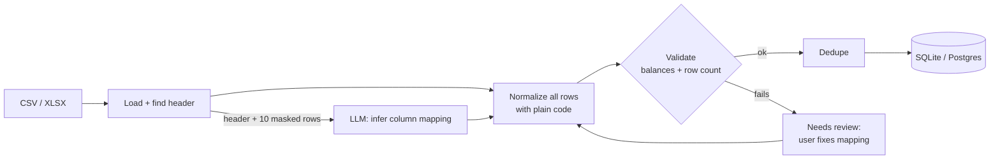

# Bank Statement Analyzer

A personal-finance ledger that works with statements from any bank. Upload a CSV or XLSX statement (PDF support comes later). The app works out the layout at runtime, normalizes every transaction into one schema, checks the result against the statement's own balances, and stores it permanently without duplicates.

There is no parser per bank. An LLM looks at a small, masked sample to infer the column layout, plain code applies that layout to every row, and strict validation catches any mistake before data is stored.

> **Status:** Phase 1 (ingestion backend) is complete. Next: categorization and UI. See the [roadmap](#roadmap).

## Architecture



The full pipeline, data model and design notes are in [docs/architecture.md](docs/architecture.md).

**Stack:** FastAPI · SQLAlchemy 2 · Alembic · pandas/openpyxl · Anthropic API (structured output) · pytest. The frontend (React + Vite + Tailwind) arrives in Phase 2.

## Screenshots

_Coming with the Phase 2 UI._

## Supported layouts

Each of these is covered by a synthetic statement in [`samples/synthetic/`](samples/synthetic) and checked against ground truth by the test suite:

| Layout | Format | Highlights |
|---|---|---|
| `in_debit_credit_ddmmyy` | CSV | Preamble lines, separate withdrawal/deposit columns, `DD/MM/YY`, Indian grouping `1,23,456.78`, totals footer |
| `us_signed_mmddyyyy` | CSV | One signed amount column, `MM/DD/YYYY` |
| `de_semicolon_eu_numbers` | CSV `;` | `DD.MM.YYYY`, `1.234,56` |
| `iso_shuffled_debit_credit` | CSV | Unusual column order, `YYYY-MM-DD` |
| `drcr_suffix_amounts` | CSV | `1,200.00 Dr` / `Cr` amounts and balances |
| `type_column_gbp` | CSV | Unsigned amount plus a `DR`/`CR` type column, `05 Jan 2024` |
| `reverse_chronological` | CSV | Newest first, detected from the balance chain |
| `no_balance_cad` | CSV | No balance column (balance checks skipped, with a warning) |
| `xlsx_native_cells` | XLSX | Real date and number cells, preamble |
| `xlsx_eu_strings` | XLSX | European number strings |
| `tsv_credit_card_positive_debits` | TSV | Charges shown as positive, `05-Jan-24` |
| `multiline_narration` | CSV | Narrations wrapped onto continuation rows |
| `opening_closing_rows_space_thousands` | CSV | Opening/closing balance lines, `12 345.00` |
| `chf_parentheses_apostrophe` | CSV | `(1'234.50)` negatives |
| `jpy_trailing_minus_no_decimals` | CSV | `1,234-` negatives, zero-decimal currency, `05JAN2024` |

Also handled: CSV with no header, CP1252/Latin-1 encodings, repeated header rows, end-of-day-only balances, same-day identical transactions, and overlapping statements.

## Privacy

- **Sent to the LLM:** the header labels and **up to 10 masked rows**. Dates, amounts and debit/credit words are kept. Narrations and names become `<text:N>` and account/reference numbers become `<digits:N>`. Preamble lines (account holder, account number) are never sent. In Phase 2 only cleaned merchant names will be sent for categorization.
- **Stored:** normalized transactions, file hashes, the column mapping and the validation report. **Not stored:** uploaded files (processed in memory), file names, full account numbers (last 4 only), passwords.
- **Logged:** import metadata only. SQL parameters are hidden even at DEBUG level.
- **Offline option:** without an API key, imports go to *needs review* and you map columns yourself. Demo mode never makes network calls.

Details are in [docs/privacy.md](docs/privacy.md).

## Setup (Windows / PowerShell)

Requirements: Python 3.11+ and Git. Node is only needed from Phase 2.

```powershell
git clone <your-repo-url> bank-statement-analyzer
cd bank-statement-analyzer
copy .env.example .env            # set ANTHROPIC_API_KEY (optional, see Privacy)
.\scripts\dev.ps1 setup           # creates backend\.venv and installs dependencies into it
.\scripts\dev.ps1 migrate         # creates backend\ledger.db
.\scripts\dev.ps1 test            # runs the test suite and prints the corpus pass rate
.\scripts\dev.ps1 run             # API docs at http://127.0.0.1:8000/docs
```

`dev.ps1` sets `PIP_CACHE_DIR=D:\dev-cache\pip` for its own process only. Override it by setting the variable yourself.

### Demo mode (synthetic data only)

```powershell
.\scripts\dev.ps1 demo            # builds backend\demo.db from samples\synthetic and serves it
```

Demo mode uses a separate database and an offline fake LLM, so it is safe for public demos and never touches your real ledger.

### Configuration

All settings come from environment variables or `.env`. See [`.env.example`](.env.example).

| Variable | Default | Purpose |
|---|---|---|
| `DATABASE_URL` | `sqlite:///backend/ledger.db` | Any SQLAlchemy URL (Postgres needs a driver) |
| `LLM_PROVIDER` | `anthropic` | `fake` for offline use |
| `ANTHROPIC_API_KEY` | unset | Without it, imports need manual mapping |
| `LLM_MODEL` | `claude-opus-5-5` | Model for schema inference |
| `LLM_EFFORT` | `medium` | Reasoning effort (`low`…`max`) |
| `MAX_UPLOAD_MB` | `20` | Upload size limit |
| `DEMO_MODE` | `false` | Forces the offline fake LLM |

## API (Phase 1)

| Method | Path | Purpose |
|---|---|---|
| `POST` | `/api/accounts` | Create an account (`last4` only) |
| `GET` | `/api/accounts` | List accounts |
| `GET` | `/api/categories` | The fixed category tree |
| `POST` | `/api/imports` | Upload a statement (`account_id`, `file`, optional `mapping` JSON) |
| `GET` | `/api/imports/{id}` | Import status, validation report, mapping |
| `GET` | `/api/imports` | List imports (`?account_id=`) |
| `POST` | `/api/imports/{id}/retry` | Re-run a `needs_review` import with the same file and a corrected mapping |
| `GET` | `/api/transactions` | List transactions (filters: account, import, date range; paginated) |

## Development

```powershell
.\scripts\dev.ps1 lint            # ruff + mypy
.\scripts\dev.ps1 format          # ruff format + autofix
.\scripts\dev.ps1 samples         # regenerate the synthetic corpus (deterministic)
```

```
backend/    FastAPI app, Alembic migrations, tests
  app/ingestion/   detect, loaders, normalize, validate, dedupe, pipeline
  app/services/    llm.py (the only LLM gateway), masking.py
frontend/   React app (Phase 2)
docs/       architecture.md, privacy.md
samples/    generate.py + synthetic/ (fake statements with ground truth)
scripts/    dev.ps1 task runner
```

## Roadmap

- [x] **Phase 1:** scaffolding, schema + migrations, CSV/XLSX ingestion with LLM schema inference, validation, dedupe, import API, tests
- [ ] **Phase 2:** layered categorizer (merchant cleanup → rules → cache → LLM), correction loop, transactions table and mapping review UI, docker-compose
- [ ] **Phase 3:** dashboard (categories, trends, income vs expense, top merchants, recurring payments, savings rate)
- [ ] **Phase 4:** text PDFs, password-protected PDFs, scanned/image fallback
- [ ] **Phase 5:** export, automatic backups, year-over-year analytics, anomaly flags
