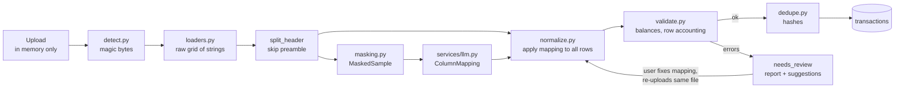
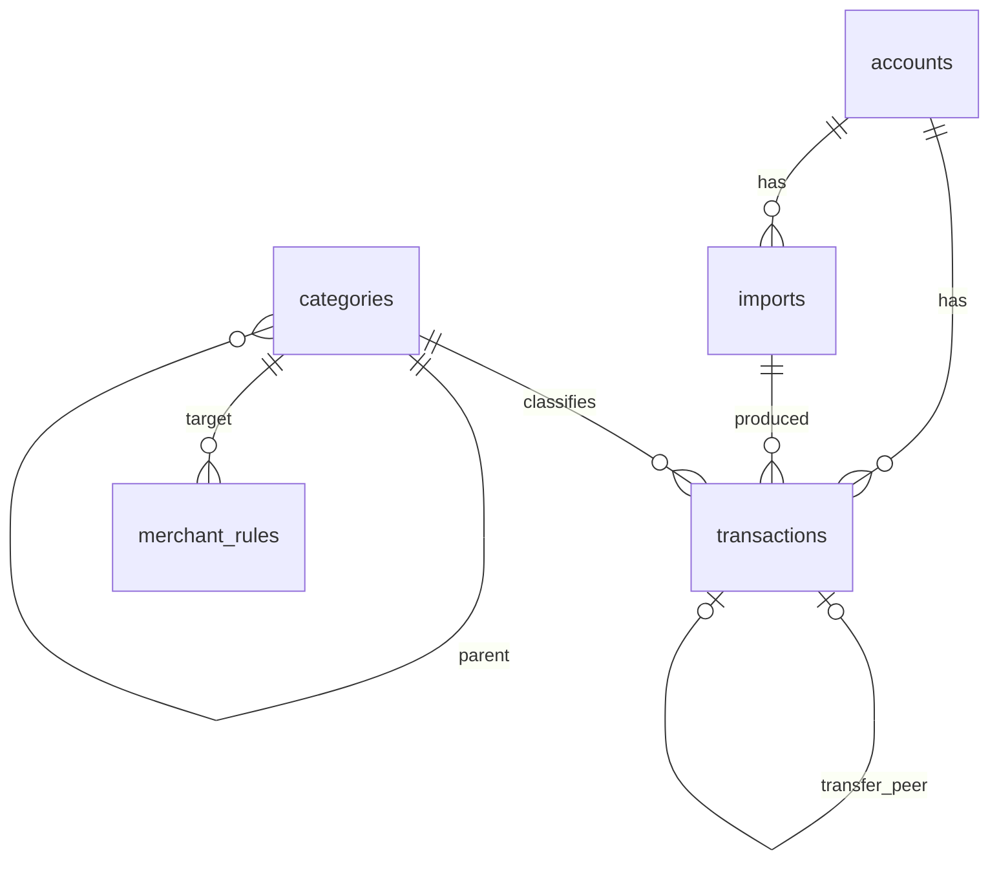

# Architecture

## Design principle: infer the layout, don't write per-bank parsers

Every bank exports statements differently: column order, date format, number format, debit/credit columns versus one signed column, Dr/Cr suffixes, preamble lines and footers. Instead of maintaining a parser per bank, the app works out the layout of each file at runtime:

1. An LLM looks at a **small masked sample** (the header plus up to 10 rows) and returns a `ColumnMapping`.
2. **Plain code** applies that mapping to every row.
3. Strict **validation** checks the result against the statement's own running balances before anything is stored.

The LLM never sees the full file and never produces the transactions themselves. If its mapping is wrong, validation catches it and the user corrects the mapping.

## Import pipeline



| Stage | Module | Notes |
|---|---|---|
| Detect | `ingestion/detect.py` | Magic bytes (`%PDF`, `PK..`, image signatures) with the extension as a tiebreaker. Phase 1 accepts CSV/TSV/XLSX. |
| Load | `ingestion/loaders.py` | CSV: encoding fallback (UTF-8, CP1252, Latin-1) and delimiter scoring across all lines, which is robust to preamble text. XLSX: pandas/openpyxl, with native dates and numbers turned into canonical strings. |
| Header | `loaders.split_header` | The first text-heavy row with 3+ cells that is followed by a dated row with 3+ cells. Files with no header get `Column 1..N`. |
| Mask | `services/masking.py` | See [privacy.md](privacy.md). |
| Infer | `services/llm.py` | `LLMClient` protocol with Anthropic, fake and unavailable implementations. Output is validated against the Pydantic `ColumnMapping` schema. |
| Normalize | `ingestion/normalize.py` | Classifies every row as a transaction, continuation (wrapped narration), skipped (opening/closing/total lines, repeated headers) or error. |
| Validate | `ingestion/validate.py` | Row accounting, running-balance chain (works with per-row or end-of-day balances), oldest-first vs newest-first detection, opening + credits − debits = closing, and agreement with stated opening/closing lines. |
| Dedupe | `ingestion/dedupe.py` | A file SHA-256 rejects re-uploads. Each transaction gets a hash of account, date, amount, normalized narration, balance and occurrence index. |

### The column mapping

```json
{
  "date_column": 0,
  "description_columns": [1],
  "amount_mode": "debit_credit",          // signed | debit_credit | amount_with_type
  "amount_column": null, "debit_column": 4, "credit_column": 5,
  "type_column": null, "balance_column": 6,
  "date_format": "%d/%m/%y",
  "decimal_separator": ".", "thousands_separator": ",",
  "currency": "INR",
  "sign_convention": "negative_is_debit", // or positive_is_debit (credit cards)
  "drcr_markers": false
}
```

It is stored on the import together with the header labels. When validation fails, the review UI (Phase 2) shows both so the user can fix the mapping, then calls `POST /api/imports/{id}/retry` with the same file and the corrected mapping. Uploads are never kept, so the file has to be sent again, and it must hash to the same value.

### Import statuses

| Status | Meaning |
|---|---|
| `completed` | Validated and stored. `inserted_count` / `duplicate_count` say what happened. |
| `needs_review` | Validation failed, or the LLM was unavailable. `validation` holds the report and `suggestions` may propose a date format. Nothing was stored. |
| `failed` | The file could not be read (no header found, corrupt spreadsheet). |

Unsupported types (PDF, images, legacy `.xls`) are rejected with HTTP 415 before any record is created. Re-uploading a completed file returns 409 with the existing import's id.

### Dedupe details

The occurrence index lets two genuinely identical rows in one statement coexist, such as two identical coffees on the same day with no balance column. Because the index is computed per statement, the same pair appearing again in an overlapping statement produces the same two hashes and is skipped. Narrations are normalized (case, punctuation, whitespace), so cosmetic differences between exports still match.

## Data model



- **accounts**: bank name, nickname, currency, and `last4` only (a DB check constraint enforces 4 characters).
- **imports**: file hash, file type, status, parser version, mapping and its source (`llm` or `user`), header labels, validation report, date range, opening/closing balance, counts.
- **transactions**: date, signed amount (negative = money out), type, balance, currency, `raw_narration` (immutable), `row_index`, `dedupe_hash` (unique), plus categorization fields (`cleaned_merchant`, `category_id`, `category_source`, `rules_version`) and transfer fields (`is_transfer`, `transfer_peer_id`) used from Phase 2.
- **categories**: a fixed two-level tree seeded by migration `0002`.
- **merchant_rules**: pattern → category, with `source` of `seed`, `user` or `llm` (Phase 2).

Money is stored as `NUMERIC(18,4)`. SQLite is the default and Postgres works through `DATABASE_URL`. Migrations are hand-written, and `tests/test_migrations.py` checks that they produce exactly the schema the ORM models describe.

## Swapping the LLM

`app/services/llm.py` is the only module that imports an LLM SDK. To use a different provider, implement `LLMClient.infer_schema(sample: MaskedSample) -> ColumnMapping` and return it from `build_llm_client`. Tests and demo mode use `FakeLLMClient`, which answers from the known mappings of the synthetic corpus.
