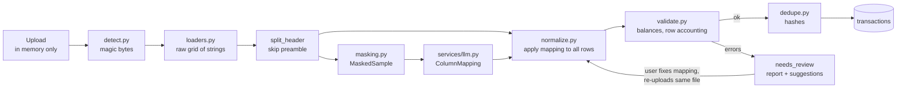
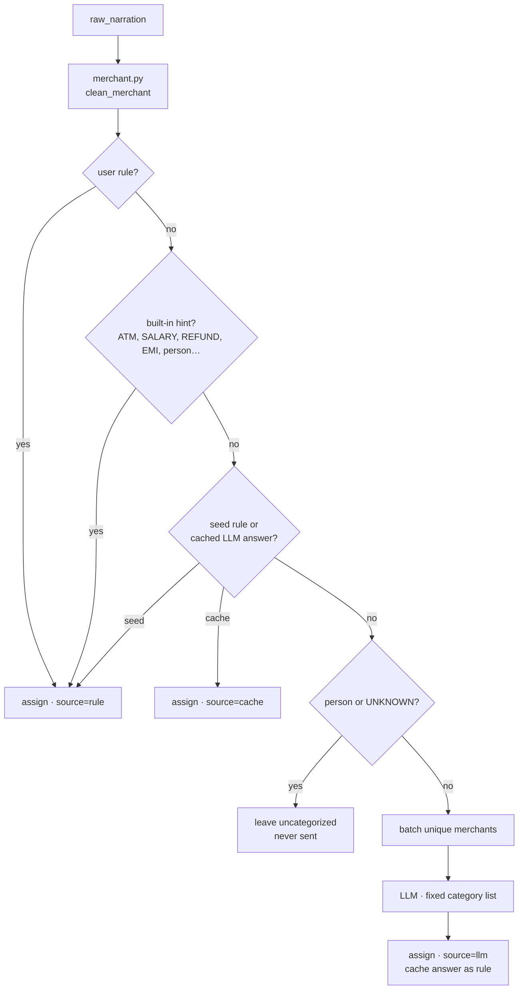
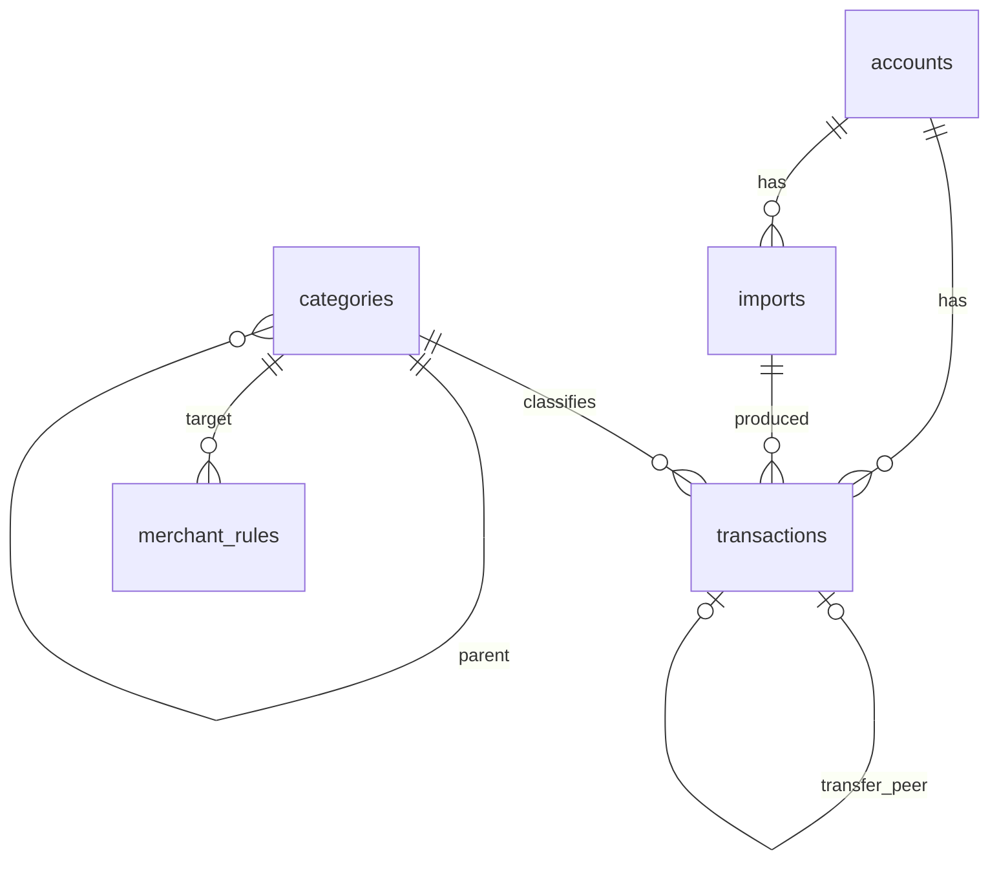

# Architecture

## Design principle: infer the layout, don't write per-bank parsers

Every bank exports statements differently: column order, date format, number format, debit/credit columns versus one signed column, Dr/Cr suffixes, preamble lines and footers. Instead of maintaining a parser per bank, the app works out the layout of each file at runtime:

1. An LLM looks at a **small masked sample** (the header plus up to 10 rows) and returns a `ColumnMapping`.
2. **Plain code** applies that mapping to every row.
3. Strict **validation** checks the result against the statement's own running balances before anything is stored.

The LLM never sees the full file and never produces the transactions themselves. If its mapping is wrong, validation catches it and the user corrects the mapping.

## Import pipeline



| Stage | Module | Notes |
|---|---|---|
| Detect | `ingestion/detect.py` | Magic bytes (`%PDF`, `PK..`, image signatures) with the extension as a tiebreaker. Phase 1 accepts CSV/TSV/XLSX. |
| Load | `ingestion/loaders.py` | CSV: encoding fallback (UTF-8, CP1252, Latin-1) and delimiter scoring across all lines, which is robust to preamble text. XLSX: openpyxl (pure Python), with native dates and numbers turned into canonical strings. |
| Header | `loaders.split_header` | The first text-heavy row with 3+ cells that is followed by a dated row with 3+ cells. Files with no header get `Column 1..N`. |
| Mask | `services/masking.py` | See [privacy.md](privacy.md). |
| Infer | `services/llm.py` | `LLMClient` protocol with Anthropic, fake and unavailable implementations. Output is validated against the Pydantic `ColumnMapping` schema. |
| Normalize | `ingestion/normalize.py` | Classifies every row as a transaction, continuation (wrapped narration), skipped (opening/closing/total lines, repeated headers) or error. |
| Validate | `ingestion/validate.py` | Row accounting, running-balance chain (works with per-row or end-of-day balances), oldest-first vs newest-first detection, opening + credits − debits = closing, and agreement with stated opening/closing lines. |
| Dedupe | `ingestion/dedupe.py` | A file SHA-256 rejects re-uploads. Each transaction gets a hash of account, date, amount, normalized narration, balance and occurrence index. |

### The column mapping

```json
{
  "date_column": 0,
  "description_columns": [1],
  "amount_mode": "debit_credit",          // signed | debit_credit | amount_with_type
  "amount_column": null, "debit_column": 4, "credit_column": 5,
  "type_column": null, "balance_column": 6,
  "date_format": "%d/%m/%y",
  "decimal_separator": ".", "thousands_separator": ",",
  "currency": "INR",
  "sign_convention": "negative_is_debit", // or positive_is_debit (credit cards)
  "drcr_markers": false
}
```

It is stored on the import together with the header labels. When validation fails, the review UI (Phase 2) shows both so the user can fix the mapping, then calls `POST /api/imports/{id}/retry` with the same file and the corrected mapping. Uploads are never kept, so the file has to be sent again, and it must hash to the same value.

### Where the mapping comes from

1. **User:** a mapping sent with the upload or with `/retry`.
2. **Saved:** the mapping of the most recent *completed* import with identical column headers, preferring the same account. It is free, offline and already proven on a real statement.
3. **LLM:** used only when there is no saved mapping, or the saved one fails validation on this file.

`imports.mapping_source` records which one was used (`user`, `saved`, `llm`). Without an API key, a saved mapping that fails validation is still stored on the import, so the review screen starts from it. No extra table is needed, because completed imports already store their headers and mapping.

### Import statuses

| Status | Meaning |
|---|---|
| `completed` | Validated and stored. `inserted_count` / `duplicate_count` say what happened. |
| `needs_review` | Validation failed, or the LLM was unavailable. `validation` holds the report and `suggestions` may propose a date format. Nothing was stored. |
| `failed` | The file could not be read (no header found, corrupt spreadsheet). |

Unsupported types (PDF, images, legacy `.xls`) are rejected with HTTP 415 before any record is created. Re-uploading a completed file returns 409 with the existing import's id.

### Dedupe details

The occurrence index lets two genuinely identical rows in one statement coexist, such as two identical coffees on the same day with no balance column. Because the index is computed per statement, the same pair appearing again in an overlapping statement produces the same two hashes and is skipped. Narrations are normalized (case, punctuation, whitespace), so cosmetic differences between exports still match.

## Categorization (Phase 2)

Runs automatically after every completed import, inside a savepoint: a categorization failure never undoes a validated import, and `POST /api/categorize` can retry later. Rows you categorized by hand (`category_source = user`) and linked transfers are never touched.



| Module | Responsibility |
|---|---|
| `categorization/merchant.py` | Narration → `CleanMerchant(merchant, channel, keywords, is_person, is_atm)`. Splits on `/ - : \| *`, drops channel words, reference numbers, masked cards, UPI handles, domains (`HELP.UBER.COM` → `UBER`) and NEFT IFSC bank codes. `UPI/<ref>/<DR\|CR>/<payee>/<bank>/…` narrations are parsed by position: the payee is the merchant, raw handles and phone numbers count as people, and bank-truncated business names (`SRI SAI SERVIC`) aren't mistaken for people. |
| `categorization/categorizer.py` | The layers above. Also handles user corrections (`apply_user_correction`) and `rules_version`. |
| `categorization/seed_rules.py` | About 60 curated brand patterns, frozen in migrations `0003` and `0004`. |
| `categorization/transfers.py` | Links equal-and-opposite amounts in two of your accounts within 3 days as own-account transfers. |

**Rule matching.** A rule's words must appear as a contiguous run in the merchant name (`POWER` matches `CITY POWER UTILITY`). Priority decides first (user 100 > LLM cache 10 > seed 0), then the longer pattern. Built-in hints sit between user rules and seed rules.

**Direction.** Money in that matches an expense category becomes *Income › Refunds*. A cached *income* answer is ignored for money out, so a salary payer's name never turns a payment to them into income.

**Corrections.** `PATCH /api/transactions/{id}` sets the category (`source = user`) and replaces any rule for that merchant with a user rule. By default it also re-labels other non-manual rows with the same merchant. Deleting and re-inserting the rule gives it a new id, which is how `rules_version` (the highest rule id at categorization time) shows that newer rules exist.

**Transfers.** Linked pairs get `is_transfer`, point at each other via `transfer_peer_id`, and are categorized *Transfers › Self Transfer*. Unlinking a pair sets `transfer_dismissed`, so the pair is never auto-linked again, and re-categorizes both sides.

## Dashboard analytics (Phase 3)

`GET /api/analytics/dashboard` (`app/analytics.py`) returns everything the dashboard shows for one filter slice in a single response, so every number on the page agrees.

| Field | Definition |
|---|---|
| excluded | `is_transfer` rows and anything categorized *Self Transfer*: moving money between your own accounts is neither income nor spending |
| `income` | money in, minus refunds |
| `spending` | money out, minus refunds (a refund undoes spending) |
| `net` / `savings_rate` | income − spending; net ÷ income (null with no income) |
| `series` | income and spending per bucket: weekly (Monday start) for ranges up to 45 days, otherwise monthly; empty buckets are filled |
| `by_category` | money out per top-level category group, ranked; the 9th group onward folds into "Other (n)" (never a 9th chart colour) |
| `pie` | money-out share per group for the donut: the groups holding colour slots 0–4, plus one grey "Other" (the rest, including uncategorized). **Slot = the group's all-time rank** (all accounts, this currency), never its rank in the current range, so filtering never repaints a slice. Capped at 6 parts so the whole reads at a glance. |
| `top_merchants` | the 10 largest `cleaned_merchant`s by money out |
| `recurring` | merchants with 3+ payments whose median gap is weekly (6–8 days) or monthly (25–35 days), with at least 70% of gaps within ±35% of the median and every amount within ±25% of the median amount. It looks back up to 400 days before the range end and drops merchants not seen for 1.5 gaps. |

Payments to other people (*Transfer to Others*) are real money out and count as spending. Each response covers a single currency: the requested one, or the most common one among the account's transactions. Aggregation runs in Python with `Decimal`: it is exact and works the same on SQLite and Postgres.

## Frontend

React + Vite + Tailwind, plain JSX. Four tabs (`#dashboard`, `#transactions`, `#import`, `#rules`):

- **Dashboard:**
  - One filter row (period presets or a custom range, account, currency) scopes everything below it.
  - Layout: hero figure (Spent), stat tiles, an income-vs-spending column chart, ranked category bars, top merchants, recurring payments.
  - Every chart has a Table twin. While new data loads, the previous numbers stay on screen, dimmed.
  - Clicking a category bar or merchant row opens the Transactions tab with the same filters (date range included).
  - The Recharts code is lazy-loaded with this tab.
- **Import:** pick or create an account, upload, see the validation report. A `needs_review` import opens the **mapping review** form, which is prefilled from the stored mapping or guessed from the header names, with live validation and one-click date-format suggestions. It re-runs the import with the same in-memory `File`.
- **Transactions:** a TanStack Table v9 view. Filtering and paging happen on the server; the table only renders the current page. Category edits happen inline, and badges show how each category was chosen (You / Rule / Cached / AI) and whether a row is an own-account transfer.
- **Rules:** list and delete merchant rules.

All network code is in `src/lib/api.js`. Form, format, date-preset and theme logic lives in `src/lib/*` and is unit-tested with Vitest. In development Vite proxies `/api` to `:8000`; in production FastAPI serves `frontend/dist` at `/`.

### Theme and visual system

- **Tokens:** colours are CSS variables in `src/index.css` (`--page`, `--surface`, `--ink`, `--line`, `--series-1`…), exposed to Tailwind via `@theme inline`. Components use roles (`bg-surface`, `text-muted`, `border-line`), never raw greys.
- **Dark mode:** a `.dark` class on `<html>` swaps the tokens. Tailwind's `dark:` variant is redefined to follow that class, so the **Light / Dark / System** switch can override the OS. The choice is stored in `localStorage` (wrapped in try/catch), and a small inline script in `index.html` applies it before first paint, so there's no flash.
- **Chart colours:** the reference data-viz palette. Income/spending use slot 1 (blue) and slot 2 (orange), validated for colour-blind separation and 3:1 contrast against both chart surfaces. Dark mode uses its own selected steps, not an inversion.
- **Chart rules:** text never wears a series colour, status colours are kept for status, and bars are at most 24 px thick with a 4 px rounded end.

## Data model



- **accounts**: bank name, nickname, currency, and `last4` only (a DB check constraint enforces 4 characters).
- **imports**: file hash, file type, status, parser version, mapping and its source (`user`, `saved` or `llm`), header labels, validation report, date range, opening/closing balance, counts.
- **transactions**: date, signed amount (negative = money out), type, balance, currency, `raw_narration` (immutable), `row_index`, `dedupe_hash` (unique), categorization fields (`cleaned_merchant` (indexed), `category_id`, `category_source`, `rules_version`), and transfer fields (`is_transfer`, `transfer_peer_id`, `transfer_dismissed`).
- **categories**: a two-level tree. The built-in part is seeded by migration `0002`. Users can add their own (`is_custom`, migration `0005`) under existing groups or as new groups, and the categorizer and LLM list pick them up automatically. Only custom categories can be renamed or deleted, because code refers to built-ins by path (`Income > Refunds`, `Transfers > Self Transfer`…).

**SQLite migrations and foreign keys.** SQLite can't `ALTER` most things, so Alembic's batch mode rebuilds the table (copy, drop, rename). With foreign keys enforced, the `DROP` would fire `ON DELETE CASCADE` / `SET NULL` on every referencing row: adding a column to `categories` would wipe sub-categories, merchant rules and transaction categories. `alembic/env.py` therefore switches enforcement off for the migration, runs `PRAGMA foreign_key_check` before committing, and switches it back on. `test_upgrades_preserve_existing_data` guards this.
- **merchant_rules**: pattern → category, with `source` of `seed` (migration `0003`), `user` (corrections) or `llm` (cached answers) and a `priority`.

Money is stored as `NUMERIC(18,4)`. SQLite is the default and Postgres works through `DATABASE_URL`. Migrations are hand-written, and `tests/test_migrations.py` checks that they produce exactly the schema the ORM models describe.

## Swapping the LLM

`app/services/llm.py` is the only module that imports an LLM SDK. To use a different provider, implement the two `LLMClient` methods and return your client from `build_llm_client`:

- `infer_schema(sample: MaskedSample) -> ColumnMapping`
- `categorize_merchants(merchants: Sequence[MaskedMerchant], categories: Sequence[str]) -> dict[int, str]`

Tests and demo mode use `FakeLLMClient`. It answers from the known mappings of the synthetic corpus and from merchants registered in tests.
